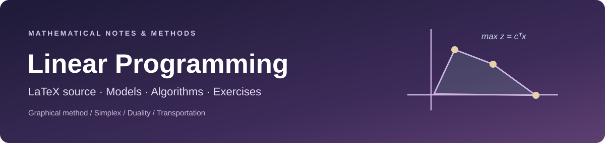
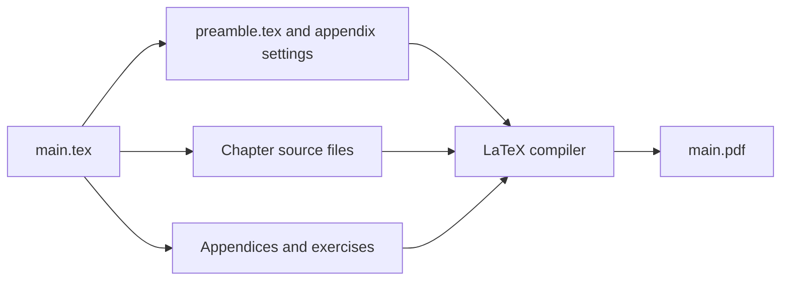
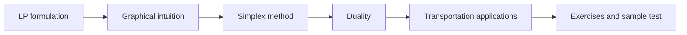

<p align="center"></p>

<h1 align="center">Linear Programming</h1>
<p align="center"><strong>Reproducible mathematical lecture notes, worked methods and exercises</strong></p>
<p align="center">
  <a href=".github/workflows/latex-build.yml"></a>
  
  <a href="LICENSE"></a>
</p>
<p align="center">
  <a href="#topics-covered">Topics</a> · <a href="#manuscript-build-flow">Document pipeline</a> ·
  <a href="#requirements">Build</a> · <a href="#project-structure">Structure</a> · <a href="CONTRIBUTING.md">Contributing</a>
</p>

## Topics covered

| | Area | Contents |
| :--: | --- | --- |
|  | **Foundations** | LP formulation and graphical method |
|  | **Algorithms** | Simplex method, exercises and tables |
|  | **Extensions** | Duality and transportation models |

## Manuscript build flow





The second diagram is a **pedagogical reading path**, not a claim that every mathematical method derives from the preceding one.

---

## Source and build guide

LaTeX source for lecture notes and exercises on linear programming topics, including simplex method, duality, and transportation models.

## Project Structure

- `main.tex`: main entry file
- `preamble.tex`: shared preamble packages and settings
- `chapters/`: core chapters and topic sections
- `appendix/`: appendix formulas, symbols, and simplex tables
- `exercise_1/`: chapter exercises
- `figures/`: figure sources (TikZ/LaTeX)
- `images/`: image assets
- `sample-test/`: sample test and answer key

## Requirements

- A TeX distribution (TeX Live or MiKTeX)
- `pdflatex` available in terminal

## Build

### Windows PowerShell

```powershell
pdflatex -interaction=nonstopmode -halt-on-error main.tex
pdflatex -interaction=nonstopmode -halt-on-error main.tex
```

Run twice to resolve references and table of contents.

## Clean Generated Files

Generated files are ignored by `.gitignore`. If needed, remove local build artifacts manually.

## Contributing

Please read [CONTRIBUTING.md](CONTRIBUTING.md) before opening pull requests.

## License

This project is licensed under the MIT License. See [LICENSE](LICENSE).
